# 经世致用主次图（可编辑）

> **材料库**：`mba_management_finance_practical.md`（详实，不删）  
> **本文件**：导航 + 主次 + 审问进度（你改标注，讨论跟这里走）  
> **阅读方式**：审问式 + 要点式（先目录/主题 → 拆要点 → 有必要时再下钻）

---

## 0. 标注约定（改这里即可）

| 标注 | 含义 |
|------|------|
| `[主]` | 当前主线，讨论优先 |
| `[次]` | 有用但暂不展开 |
| `[暂缓]` | 知道位置即可，不下钻 |
| `[目录]` | 只到目录/主题层，尚未要要点 |
| `[要点]` | 已要过要点清单，可再决定是否下钻 |
| `[下钻]` | 正在/准备读细节或书中对应章 |
| `[够用]` | 对本目标已够，停止 |

**你怎么改**：改节点后的标注；增删节点；把某枝从 `[目录]` 改成 `[要点]` / `[下钻]`。改完在对话里说一声，或让我读本文件。

---

## 1. 结构图（预览用 · flowchart，兼容 Cursor）

> 说明：Cursor 对 `mindmap` 类型常报 Syntax Error；下面用 `flowchart` 表达同一层级，可预览。

```mermaid
flowchart TB
  ROOT["经世致用主图"]

  ROOT --> CORE["公共核心"]
  ROOT --> INV["场景A 投资看企业"]
  ROOT --> OPS["场景B 业务经营"]
  ROOT --> TOOL["工具与约束层"]
  ROOT --> META["方法与地图层"]

  CORE --> C1["读表与现金流质量"]
  CORE --> C2["成本与单元经济"]
  CORE --> C3["商业模式与价值链"]
  CORE --> C4["激励与动机"]
  CORE --> C5["现金与账期"]

  INV --> I1["财务主战场"]
  INV --> I2["管理为读懂生意"]
  INV --> I3["非财务投资栈"]
  I1 --> I1a["三张表与勾稽"]
  I1 --> I1b["利润vs现金流"]
  I1 --> I1c["粉饰与杠杆"]
  I1 --> I1d["公司金融直觉"]
  I3 --> I3a["治理与激励"]
  I3 --> I3b["行业与竞争"]
  I3 --> I3c["信息获取方法"]

  OPS --> O1["管理主战场"]
  OPS --> O2["财务为经营保命"]
  O1 --> O1a["战略与商业模式"]
  O1 --> O1b["组织行为精要"]
  O1 --> O1c["运营与预算"]
  O2 --> O2a["管理会计选章"]
  O2 --> O2b["现金预测"]

  TOOL --> T1["财务会计教材层"]
  TOOL --> T2["管理会计教材层"]
  TOOL --> T3["统计量化"]
  TOOL --> T4["经济学约束"]
  TOOL --> T5["博弈论浅层"]

  META --> M1["MBA课表对照"]
  META --> M2["书单与顺序"]
  META --> M3["机构角色与兼岗技能"]
  META --> M4["市场参与者结构"]
```



---

## 2. 可编辑主次树（讨论以本树为准）

### 2.1 公共核心 · `[主]`

- `[主][目录]` 读表与现金流质量 → 材料 §二 / §3.1 / §6.C
- `[主][目录]` 成本与单元经济 → 材料 §二 / §4.2 / 管理会计选章
- `[次][目录]` 商业模式 / 价值链 → 材料 §二；对接产业分析
- `[主][目录]` 激励与动机 → 材料 §二；OB 精要动机/权力章
- `[次][目录]` 现金与账期 → 材料 §二

### 2.2 场景 A：投资 · `[主]`

- `[主][目录]` 财务主战场（三张表、利润vs现金流、粉饰、杠杆、估值直觉）
- `[次][目录]` 管理为读懂生意（模式、激励、竞争粗框）
- `[主][目录]` 非财务栈：治理、行业、信息获取（§十 / §十一）
- `[次][目录]` 兼岗技能三角：研究员 / PM / 交易员（§十三）
- `[暂缓][目录]` 机构分类与市场占比（§十二 / §十四）— 知道位置即可

### 2.3 场景 B：经营 · `[次]`（与投资并行时降级）

- `[次][目录]` 管理主战场：战略通识、OB 精要、运营预算
- `[次][目录]` 管理会计：本量利、相关成本、预算差异
- `[暂缓][目录]` 营销/领导力流派等 MBA 全科展开

### 2.4 工具与约束 · 默认 `[次]` / `[暂缓]`

- `[次][目录]` 财务会计教材（莉比中译 / 手把手）— 服务读表，非整本会计专业
- `[次][目录]` 管理会计教材（亨格瑞中译选章）
- `[暂缓][目录]` 统计量化深入
- `[暂缓][目录]` 经济学全科
- `[暂缓][目录]` 博弈论（§十五：相关但非主线）

### 2.5 方法与地图 · 按需

- `[够用]` MBA/名校课表对照（§五）— 已作地图用，不必再学「课表本身」
- `[次][目录]` 书单与学习顺序（§六 / §七）
- `[目录]` 当前在读/待审的书：_（你填书名，如 Essentials of OB）_

---

## 3. 审问式阅读：你问我时怎么答

你的方式：**目录 → 主题要点 → 必要时下钻**；未详读全书时仍可审问。

### 3.1 硬约束（你强调）

1. **「这里面有什么」必须高度准确 + 高度概括，且不能省略。**  
   - 目录/章节清单：按原书结构列全，不静默跳章、不合并到看不出原结构。  
   - 主题要点：覆盖该范围内的完整要点集；可压缩表述，但**不可漏项**。  
   - 你会对答案做 check；我宁可列表略长，也不许「挑重点而漏掉其余」。  
2. **「不省略」≠ 原文照搬**：给的是可核对的结构与要点概括，不是大段版权正文。  
3. **有书稿时以你提供的 PDF/EPUB（或目录页）为权威**；无书稿时明确写「依据公开目录/版次，待你对照核验」，不装成已读你的文件。

### 3.2 双程处理（与你同法 · 一起做）

```
自顶而下（拆）                         自下而上（构）
全书 → 部/篇 → 章 → 节 → 要点     要点 → 节结论 → 章骨架 → 主题判断 → 回写主次图
        │                                      │
        └──────── 每一层你 check 后，才进下一层 / 才允许上卷 ────────┘
```

| 方向 | 做什么 | 产出（供你 check） | 停止条件 |
|------|--------|-------------------|----------|
| **↓ 顶向下** | 列本层**完整**子项 + 每项高度概括「是什么」 | 编号清单，不漏项 | 你标「此枝够用 / 暂缓」或点名下一刀 |
| **↓ 再下一层** | 只处理你点名的子项；其余保持「已知有、未拆」 | 该子项的完整要点 | 同上 |
| **↑ 底向上** | 用已 check 的要点，收成上一层的**结构骨架**（不是再写一篇详文） | 「本章/本主题成立的骨架句」+ 未决问题 | 骨架你认可后，回写 §2 / §4 标注 |

**协作分工**：

- **我**：每一刀给出完整、准确、高度概括的清单；标明依据（书签/页码/你贴的目录）；大 PDF 只切片不整本灌入。  
- **你**：check 对错与漏项；决定哪一枝继续 ↓、哪一枝标够用、何时开始 ↑ 上卷。  
- **一起**：同一枝未完成 check，不跳到无关枝；上卷只用已确认要点，不用我未核对的记忆。

### 3.3 分层答法（问哪层答哪层）

| 你问的层级 | 我应给出 | 我不应做 |
|------------|----------|----------|
| **目录/主题层** | **完整**目录树（章→节若你要到节）；每章一句「管什么」；邻主题边界 | 漏章；只挑「重要章」；假装已读你的 PDF |
| **要点层** | 该范围内**完整**要点清单（编号供 check）；高度概括；可另标用途但不删项 | 用「重点摘要」偷换「全量要点」 |
| **下钻层** | 只针对你点名的要点：定义、判别规则、常见误判、邻接关系 | 自动扩成全书第二份详实笔记 |
| **上卷层** | 用已确认要点拼回上一层骨架；列出仍缺的证据 | 用未 check 的内容「圆」成故事 |
| **取舍层** | 差别维度 + 取舍口径 | 替你拍板却不说差别 |

**默认纪律**：

1. 先对齐：当前是 ↓ 还是 ↑，卡在哪一层。  
2. 每轮末一行：`建议下一刀：↓ …` 或 `可上卷：↑ …` 或 `此处可标 [够用]`。  
3. 材料库只作索引（§x）；书内「有什么」以书稿/目录为准。

---

## 4. 当前焦点（你改）

- **焦点枝**：组织行为学（第一主线）· Robbins & Judge 完整版 18 章
- **当前层**：`[目录]` ↓ 全书→章（已出，待你 check）
- **书稿**：`/Users/piliepeng/Documents/mba/`；章表见 `notes/topics/ob_chapter_map.md`
- **最近结论**：完整版权威目录取自英文 73MB PDF Brief Contents；中文第16版为扫描抽不出目录字；精要=17章（无独立 HR 章）

---

## 5. 修订记录

| 日期 | 谁 | 改了什么 |
|------|----|----------|
| 2026-11-14 | 助手 | 初建；`mindmap` 改为 `flowchart` 以兼容预览；写入审问式答法 |
| 2026-11-14 | 助手 | §3 硬约束：有什么=准确+概括+不省略；书稿以你提供的 PDF/EPUB 为准 |
