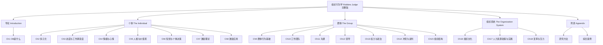
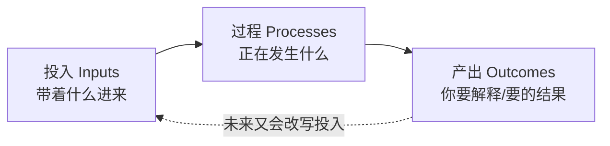

# 组织行为学 · 章级目录图（↓ 第一刀 · 供 check）

> **状态**：`[目录]` 层 — 每章「讲什么」高度概括；尚未下钻要点。  
> **权威依据（本轮）**：你目录中英文完整版 PDF 的 Brief Contents（可核页）。  
> **路径**：`/Users/piliepeng/Documents/mba/Organizational behavior (Robbins, Stephen P., 1943-, Judge, Tim) (z-library.sk, 1lib.sk, z-lib.sk).pdf`  
> **版次族**：Robbins & Judge *Organizational Behavior*（书内 Brief Contents 为 18 章结构；中文「组织行为学第16版」同属完整版族，但该 PDF 为扫描件，目录文字抽不出，章名以本英文 Brief Contents 为准，请你对照中文版目录 check）。  
> **同目录对照本**：`组织行为学精要` / `Essentials of organizational behavior` = **17 章精要**（无独立「人力资源政策与实践」章）。

---

## 全书骨架（4 部 + 附录）

| 部 | 英文 Brief Contents | 管什么 |
|----|---------------------|--------|
| Introduction | Ch.1 | 学科是什么、怎么研究、总模型 |
| The Individual | Ch.2–8 | 个人：多元、态度、情绪、人格、知觉决策、激励 |
| The Group | Ch.9–15 | 群体/团队、沟通、领导、权力政治、冲突谈判、结构 |
| The Organization System | Ch.16–18 | 文化、人力资源政策与实践、变革与压力 |
| 附录等 | Appendix + Cases | 研究方法；综合案例（非主知识章） |

---

## 枝干思维导图（目录层 · 部→章）

> 由 Brief Contents 生成；**只到章**，节/要点未展开。  
> 用 `flowchart`（Cursor 对 `mindmap` 常报错）。预览本文件即可。

**精要版枝干差异**：无 `Ch17 人力资源政策与实践`；其余章主题与上图对应（精要为 17 章）。

---

## 每章讲什么（完整 · 不省略 · 一句概括）

页码为英文该 PDF 正文起始页（Brief Contents）。

| # | 章名（英 / 常用中译） | 页 | 本章讲什么（高度概括） |
|---|----------------------|----|------------------------|
| 1 | What Is Organizational Behavior? / 组织行为学是什么 | 2 | 定义 OB；管理活动与人际技能；用系统研究补直觉；贡献学科；权变无绝对；当代挑战；**投入–过程–产出**总模型与就业技能框 |
| 2 | Diversity in Organizations / 组织中的多元化 | 40 | 表层/深层多元；歧视；传记特征与其他差异；能力；多元化管理策略 |
| 3 | Attitudes and Job Satisfaction / 态度与工作满意度 | 72 | 态度成分与态度–行为关系；主要工作态度；工作满意度的成因与结果；不满时的行为反应 |
| 4 | Emotions and Moods / 情绪与心情 | 100 | 情绪/心情/情感；来源；情绪劳动；情感事件理论；情商与情绪调节；在选拔、决策、激励、领导等中的应用 |
| 5 | Personality and Values / 人格与价值观 | 134 | 人格测量框架（含 Big Five、黑暗三联征等）；情境与特质激活；价值观；个人–工作/组织匹配；文化价值观框架 |
| 6 | Perception and Individual Decision Making / 知觉与个体决策 | 168 | 知觉与归因；判断捷径；理性/有限理性决策；常见偏差；个体与组织约束；决策伦理；创造力与创新 |
| 7 | Motivation Concepts / 激励理论（概念） | 206 | 激励定义；早期理论；当代理论（目标、公平/公正、期望等）；工作场所激励含义 |
| 8 | Motivation: From Concepts to Applications / 激励：从概念到应用 | 242 | 工作特征模型与工作再设计；弹性工作安排；员工参与；用奖酬、福利、内在报酬落地激励 |
| 9 | Foundations of Group Behavior / 群体行为基础 | 274 | 群体定义与分类；角色、规范、地位、规模、凝聚、多元等属性；群体决策及其技术 |
| 10 | Understanding Work Teams / 理解工作团队 | 310 | 群体 vs 团队；团队类型；高效团队条件；培养团队取向；何时不该用团队 |
| 11 | Communication / 沟通 | 342 | 沟通过程与方向；组织沟通与渠道选择；说服；障碍；危机与跨文化沟通 |
| 12 | Leadership / 领导 | 380 | 领导定义；特质/行为/权变理论；LMX、交易型与变革型等当代理论；真诚/道德领导；领导概念的边界与发展 |
| 13 | Power and Politics / 权力与政治 | 420 | 权力定义与基础；权术；权力对人的影响；组织政治行为的原因、结果与伦理 |
| 14 | Conflict and Negotiation / 冲突与谈判 | 456 | 冲突定义、类型与过程；谈判策略与过程；影响谈判效果的个体差异 |
| 15 | Foundations of Organization Structure / 组织结构基础 | 490 | 结构六要素；常见与新型结构设计；结构差异原因；结构与员工行为 |
| 16 | Organizational Culture / 组织文化 | 524 | 文化定义与功能；如何形成与维系；员工如何习得；道德文化与积极文化；全球化含义 |
| 17 | Human Resource Policies and Practices / 人力资源政策与实践 | 560 | 招聘选拔、培训开发、绩效管理等 HR 实践如何塑造行为与态度（**完整版有；精要版通常无独立此章**） |
| 18 | Organizational Change and Stress Management / 组织变革与压力管理 | 602 | 变革动力与阻力；变革管理方法；学习型/可变文化；工作压力来源、后果与管理 |
| App | Research in Organizational Behavior / OB 研究方法 | 644 | 如何做/读 OB 研究（附录，非主线实务章） |
| — | Comprehensive Cases | 651 | 综合案例（练习材料） |

---

## 与同目录其他 OB 书的关系（便于你选刀）

| 文件 | 角色 | 章数差异 |
|------|------|----------|
| `Organizational behavior (Robbins...Judge, Tim).pdf`（约 73MB） | **本轮完整版权威目录来源** | 18 章 + 附录 |
| `Organizational Behavior (Stephen Robbins Timothy Judge).pdf`（约 24MB） | MyManagementLab 增强版，书签极细，章序同完整版族 | 18 章结构 |
| `组织行为学-第16版-....pdf`（约 138MB） | 中文完整版；**扫描**，工具抽不出目录字 | 应对齐上表 18 章（请你目检） |
| `组织行为学精要....pdf` / `Essentials of organizational behavior....pdf` | 精要 | **17 章**：主题与上表 1–16+18 对应，**无独立 Ch.17 HR** |

---

## Ch.1 要点层（供 check）

> **依据**：英文完整版 PDF Contents（Ch.1 细目）+ 正文定义/`Implications for Managers`（页约 idx 44–78）。  
> **范围**：知识要点全列；章末练习/案例/Point-Counterpoint 单列「教辅」，不并入知识要点也不删。

### 学习目标（书内 1-1～1-7 口径）

1. 人际技能在职场为何重要  
2. OB 的定义  
3. 系统研究如何增进对 OB 的理解  
4. 贡献于 OB 的主要行为科学学科  
5. 为何 OB 几乎没有绝对规律  
6. 管理者应用 OB 的挑战与机会  
7. 本书 OB 模型的三个分析层次  

### 知识要点（完整 · 高度概括）

| # | 要点 | 一句概括 |
|---|------|----------|
| 1 | 人际技能的重要性 | 仅靠技术不够；人际/人的技能决定经理能否有效；良好人际环境与绩效、吸引留才、满意度、压力/离职、社会责任意识相关 |
| 2 | 管理者与组织的定义 | **经理**：通过他人达成目标；**组织**：持续协调的社会单位，为共同目标运作 |
| 3 | 管理四职能 | 计划、组织、领导、控制（leading 含激励、沟通渠道、冲突处理等） |
| 4 | 管理角色（Mintzberg） | 经理实际工作可归入人际、信息、决策等角色类别（书中展开 Mintzberg 角色） |
| 5 | 管理技能三类 | **技术技能**、**人际技能**、**概念技能** |
| 6 | 成功 vs 有效的经理活动 | Luthans：升迁「成功」与团队「有效」所依赖的活动组合不同（如联网/沟通权重差异）——晋升标准未必等于带人有效 |
| 7 | OB 定义 | 研究个体、群体与结构对组织内行为的影响，并应用该知识提升组织有效性 |
| 8 | 系统研究补直觉 | 用可检验的因果与证据替代纯直觉/坊间管理书；**系统研究**+证据导向 |
| 9 | 大数据与 OB | 数据可用于描述、预测与改进决策；强调用指标检验因果关系（非口号管理） |
| 10 | 贡献学科 | **心理学**（个体）；**社会心理学**（人际影响、态度、群体等）；**社会学**（组织/群体系统）；**人类学**（文化与环境） |
| 11 | 几乎无绝对 / 权变 | 人与情境差异大；关系常被**权变变量**调节，少有放之四海皆准的定律 |
| 12 | 挑战与机会清单 | 经济压力；持续全球化；劳动力人口结构；劳动力多元化；客户服务；人际技能；网络化组织；社交媒体；员工福祉；积极工作环境；伦理行为（含 CSR 相关意识） |
| 13 | OB 模型总览 | 简化现实的框架：**投入 → 过程 → 产出** |
| 14 | 三层次分析 | **个体 / 群体 / 组织** 三层，后文按此组织 |
| 15 | 投入（Inputs） | 进入组织已带有的变量（如个体人格/价值观、群体结构、组织文化等——章内定义层） |
| 16 | 过程（Processes） | 由投入引发、导向结果的行动（个体/群体/组织层各有过程） |
| 17 | 产出（Outcomes） | 受影响的关键结果；个体层如态度、压力、任务绩效、公民行为、离职等；群体层如凝聚与群体运作；组织层如生产率、生存等（章内按层列举） |
| 18 | 对管理者的启示（章末） | 少用错误概括、认人认情境；用度量解释因果；练人际技能；技术/概念技能与 OB 新趋势（如大数据）同步；用 OB 改善质量与生产率、授权、变革、客户服务、工作—生活冲突等 |

### 教辅材料（有，但不算知识主干）

- Myth or Science?（如 MBWA）  
- An Ethical Choice / Career OBjectives 短栏  
- Point/Counterpoint；Questions for Review；Experiential Exercise；Ethical Dilemma；Case Incident 1–2  

### Ch.1 核心骨架版（先立架，再挂靠）

> **你的目标**：人员管理方法论 + 理论依据大概了解。  
> **本章真正搭起来的东西**：书末给出的 **OB 基本模型**（Exhibit 1-5）——后文所有章都挂在这张网上。  
> **读法**：先记住骨架；其余小节只回答「为何需要它 / 谁用它 / 怎么用它 / 知识从哪来」。

#### 1. 核心骨架（先造出来）

人员管理要解释和干预的，是组织里「人的行为如何通向结果」。Ch.1 把它收成一张网：

再叠 **三个分析层次**（个体 → 群体 → 组织；后文章序也按此走）：

| | 投入（名词：已在场的条件） | 过程（动词：正在做的事） | 产出（要解释/预测的结果） |
|--|---------------------------|--------------------------|---------------------------|
| **个体** | 多元特征、人格、价值观等 | 情绪心情、激励、知觉、决策等 | 态度与压力、任务绩效、公民行为、退缩行为等 |
| **群体** | 群体结构、角色、团队责任等 | 沟通、领导、权力政治、冲突谈判等 | 群体凝聚、群体运作 |
| **组织** | 结构、文化等（长期形成） | HR 实践、变革实践等 | 生产率（有效×效率）、组织生存 |

**骨架用法（方法论一句话）**：管人时先定层次 → 看清投入/过程/产出哪一段出问题 → 再选干预点；产出还会回流改写下一轮投入。

#### 2. 使用骨架时的两条约束（理论依据 · 浅）

| 约束 | 含义 | 对管人的直接含义 |
|------|------|------------------|
| **系统研究 / 证据** | 用可检验的因果关系补直觉；数据/指标是手段 | 少靠概括与管理畅销口号；先观察再下结论 |
| **权变（几乎无绝对）** | 「做法→结果」常被情境变量调节 | 同一招对不同人/情境效果不同 → 诊断+匹配，不背万能清单 |

OB 的定义就是在说这张网：研究 **个体、群体、结构** 如何影响组织内行为，并用来提升有效性。知识大致来自心理 / 社会心理 / 社会 / 人类——后文具体理论从这些学科长出，Ch.1 不必展开。

#### 3. 其余小节如何向骨架靠拢

| 书中小节 | 挂在骨架的哪一格 | 精炼后只保留 |
|----------|------------------|--------------|
| 人际技能为何重要 | **为何需要这张网** | 经理靠他人达成目标；技术不够，必须会读人、干预行为→结果 |
| 经理 / 组织定义；四职能；三类技能 | **谁用骨架、在哪个职能里用** | 使用者=经理；管人主战场在**领导**（激励、沟通、冲突），并接计划/组织/控制；主练**人际技能** |
| Mintzberg 角色 | 同上（降级） | 只记「经理同时扮演人际/信息/决策等多角色」→ 骨架要能支撑多角色，不背角色表 |
| 成功 vs 有效（Luthans） | **别用错产出指标** | 「自己升迁」≠「团队有效」；选产出时要对准组织有效，而非个人政治结果 |
| 系统研究；大数据 | → **约束：证据** | 并入上节「证据」；大数据不单列 |
| 贡献学科 | → **约束：理论来源** | 并入上节四学科一行 |
| 几乎无绝对 | → **约束：权变** | 并入上节「权变」 |
| 挑战与机会长清单 | **骨架要能承接的当代情境**（投入/过程侧压力） | 不背清单；知道全球化、多元、远程/网络、福祉、伦理等会改变投入与过程即可 |
| Coming Attractions: OB Model | **骨架本体** | 即本节第 1 块 |
| Implications for Managers | **骨架操作口诀** | 认人认情境；用度量想因果；练人际；用 OB 改善绩效/变革/客户/工作生活平衡等——都是在用这张网 |
| 教辅（Myth/案例/练习） | 不进骨架 | 需要举例时再查 |

#### 4. 压成可携带的 Ch.1 结论

> 管人 = 在 **个体/群体/组织** 三层上，沿着 **投入→过程→产出**（产出回流）做诊断与干预；用 **证据** 想因果，用 **权变** 匹配情境；经理以 **人际技能** 为主工具，且以 **组织有效** 为产出，而非个人升迁幻象。

### 进度

- [x] ↓ 全书 → 部 / 章  
- [x] ↓ Ch.1 → 完整要点表（对照用）  
- [x] ↓ Ch.1 → **核心骨架 + 小节挂靠**（上节）  
- [ ] 你 check：骨架是否就是你要的「章的中轴」；挂靠是否有放错/应再压缩  
- [ ] 通过后 → Ch.2：仍用此骨架，看该章填的是哪一格（个体层投入等）  

建议下一刀：你改骨架或挂靠表；定稿后进 Ch.2，按「填哪一格」提取。
